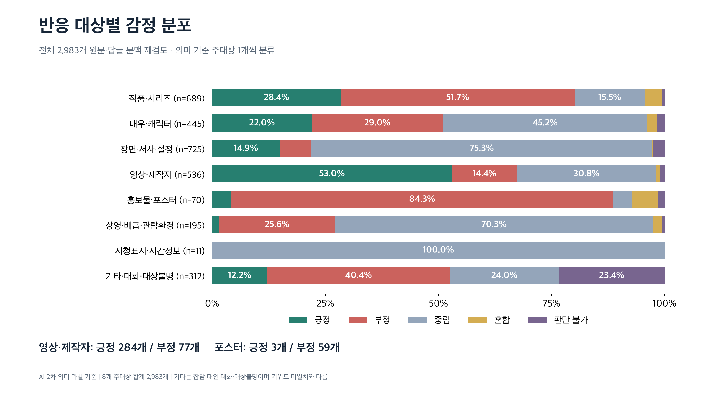

# CNT3054 7조 시리즈 콘텐츠 유튜브 댓글 반응 분석

마블 관련 유튜브 영상 4개의 공개 댓글과 답글을 수집하고, 댓글의 반응 대상·구분·감성을 함께 분석하는 문화콘텐츠와 자연어처리 팀 프로젝트입니다. 기존 수집 구조와 6주차 TF-IDF·로지스틱 회귀 실습 코드를 확장했습니다.

## 최신 수집 결과

2026년 10월 15일 23:19 KST 수집 실행의 API 통계입니다. 조회수·좋아요·댓글 수는 이후 달라질 수 있습니다.

| 영상 | 조회수 | 좋아요 | API 댓글 수 | 최상위 | 답글 | 수집 합계 |
|---|---:|---:|---:|---:|---:|---:|
| [마블 22편 몰아보기](https://youtu.be/lekS3GR1jps) | 6,063,118 | 22,261 | 682 | 457 | 225 | 682 |
| [엔드게임 앙코르](https://youtu.be/C-NKIKiQCNE) | 3,166,090 | 10,976 | 1,330 | 878 | 452 | 1,330 |
| [둠스데이 전 필수 내용](https://youtu.be/LMtoL902Ddo) | 2,295,666 | 10,559 | 595 | 484 | 111 | 595 |
| [닥터둠 전리품과 빌런 떡밥](https://youtu.be/MHLoq1b2HQE) | 1,049,055 | 4,402 | 376 | 265 | 111 | 376 |
| **합계** | | | **2,983** | **2,084** | **899** | **2,983** |

최상위 댓글은 영상별 5·9·5·3페이지에서 `no_next_page`로 종료했습니다. 답글이 있는 255개 스레드도 마지막 페이지까지 조회했고 오류는 없었습니다. 고유 댓글 ID, 부모 댓글 연결, CSV/JSON 건수와 API 댓글 합계가 일치했습니다. 삭제·숨김 등 API에 공개되지 않는 댓글은 포함하지 않습니다.

기존 보고서의 몰아보기 영상 666개는 과거 수집 시점의 수치입니다. 이번 재수집 시점에는 682개입니다. 기존 1차 데이터 448행은 당시 최상위 댓글만 저장한 기록입니다.

## 전체 댓글 의미 분류 재검토

2026년 10월 16일 전체 원댓글 2,084개와 답글 899개를 원문·부모 문맥과 함께 다시 읽었습니다. 기존 키워드 일치 구분은 주요 결과에서 제외하고 의미 기준의 주대상으로 대체했습니다. 댓글당 주대상 1개를 정해 합계가 2,983개와 일치합니다. 감성은 별도 축입니다. AI의 2차 참조 라벨이며 사람의 합의 정답은 아닙니다.

- 작품명이 없는 “희대의 명작”도 작품 평가로 구분합니다.
- ‘성길이·욘두’ 등 캐릭터 이름과 ‘캅틴’ 등 문맥으로 해석 가능한 오타를 반영합니다.
- 포스터 평가와 상영관·배급 불만을 영화 자체 평가와 분리합니다.
- 주대상이 바뀌거나 세분화된 댓글은 307개, 감성이 수정된 댓글은 14개입니다. 중복을 제외한 판정 변경 댓글은 318개입니다.

| 영상 | 긍정 | 부정 | 중립 | 혼합 | 판단 불가 | 합계 |
|---|---:|---:|---:|---:|---:|---:|
| 기존 몰아보기 | 190 | 268 | 174 | 17 | 33 | 682 |
| 엔드게임 앙코르 | 310 | 284 | 679 | 16 | 41 | 1,330 |
| 둠스데이 전 스토리 | 185 | 144 | 242 | 7 | 17 | 595 |
| 닥터둠·빌런 떡밥 | 45 | 152 | 150 | 9 | 20 | 376 |
| **합계** | **730** | **848** | **1,245** | **49** | **111** | **2,983** |

| 의미별 주대상 | 건수 | 전체 대비 | 긍정 | 부정 | 중립 | 혼합 | 판단 불가 |
|---|---:|---:|---:|---:|---:|---:|---:|
| 작품·시리즈 | 689 | 23.1% | 196 | 356 | 107 | 26 | 4 |
| 배우·캐릭터 | 445 | 14.9% | 98 | 129 | 201 | 10 | 7 |
| 장면·서사·설정 | 725 | 24.3% | 108 | 51 | 546 | 1 | 19 |
| 영상·제작자 | 536 | 18.0% | 284 | 77 | 165 | 4 | 6 |
| 홍보물·포스터 | 70 | 2.3% | 3 | 59 | 3 | 4 | 1 |
| 상영·배급·관람환경 | 195 | 6.5% | 3 | 50 | 137 | 4 | 1 |
| 시청표시·시간정보 | 11 | 0.4% | 0 | 0 | 11 | 0 | 0 |
| 기타·대화·대상불명 | 312 | 10.5% | 38 | 126 | 75 | 0 | 73 |

기존 ‘키워드 미일치’ 1,494개 중 1,226개는 의미상 구체적인 반응 대상으로 구분됩니다. 나머지 268개는 기타·대화·대상불명입니다. 새 전체 기타 312개(10.5%)는 키워드 미일치 비율이 아니라 잡담·대인 대화·대상불명이라는 의미 범주입니다. 기존 50.1%를 실제 기타 반응 비율로 해석하면 안 됩니다.



## 재검토 라벨로 다시 학습한 감성 이진 분류 모델

수업의 TF-IDF·로지스틱 회귀 절차로 새로 학습했습니다. 작품·캐릭터·장면·영상 대상의 명확한 긍정/부정을 사용하고, 포스터·관람환경·기타와 중립·혼합·판단 불가는 명시적 허용 목록으로 학습에서 제외했습니다. 외부 리뷰 코퍼스나 합성 리뷰 120개를 최신 실험 학습에 사용하지 않았습니다.

- 이진 후보 1,299행 중 정규화 동일 입력의 상충 라벨 7행을 제외하여 1,292행을 입력했고, 정규화 중복 5행 제거 후 1,287행을 사용했습니다.
- 연결 그룹 1,054개. seed=42, train 767 / validation 264 / test 256입니다.
- 동일 원댓글-답글 및 동일 정규화 본문은 같은 그룹으로 묶었습니다. 답글 입력에는 부모 댓글을 포함합니다.
- 단어장·IDF·LR 계수는 train에서만 학습합니다. 검증 Macro-F1로 후보를 선택하며 validation을 합쳐 재학습하지 않습니다. C=1.0, max_iter=1000입니다.

| 검증 후보 | Accuracy | Macro-F1 |
|---|---:|---:|
| majority_baseline | 0.5265 | 0.3449 |
| unigram | 0.7348 | 0.7280 |
| unigram_bigram | 0.7386 | 0.7285 |

| 최종 테스트 | Accuracy | Macro-F1 |
|---|---:|---:|
| majority_baseline | 0.5234 | 0.3436 |
| unigram_bigram | 0.7969 | 0.7961 |

검증에서 선택된 모델은 Unigram + Bigram TF-IDF + LR입니다. 테스트 256개 중 204개가 일치했습니다. 혼동행렬은 행=AI 참조, 열=모델 예측, 순서=부정·긍정일 때 `[[94, 28], [24, 110]]`입니다. 긍정 Precision 0.7971, Recall 0.8209, F1 0.8088입니다.

**이 수치는 AI 참조 라벨과의 홀드아웃 일치도이며 사람 합의 정답에 대한 검증된 정확도가 아닙니다.** 이전 Accuracy 0.7143 실험과는 라벨·대상 필터·분할 구성이 달라 동일 조건의 성능 개선으로 직접 비교할 수 없습니다. 이번 작업에서 새로운 알고리즘이나 대규모 튜닝을 도입하지 않았습니다. 전체 예측에는 학습 행이 포함되므로 `evaluation_split`을 확인해야 합니다.

[재검토 결과와 분류 기준](docs/review_v2/재검토결과.md), [검증·테스트 수치](docs/review_v2/metrics.json), [발표용 시각자료](docs/review_v2)를 확인할 수 있습니다. 원문 댓글과 댓글별 라벨 파일은 별도로 전달합니다.

## 설치와 실행

```bash
python3 -m venv .venv
.venv/bin/python -m pip install -r requirements-analysis.txt
```

프로젝트의 `.env`에 `YOUTUBE_API_KEY=발급받은키`를 설정합니다. 기존 `google_cloud_api_key` 이름도 지원합니다. API 키와 `.env`는 커밋하지 않습니다. 영상 목록은 `videos.json`에서 관리합니다.

```bash
# 네 영상 최상위 댓글과 답글 수집 및 기본 분석
.venv/bin/python run_pipeline.py --include-replies --max-pages 100

# 과거 키워드 탐색용 구분 (주요 의미 분석과 별도)
.venv/bin/python categorize_comments.py --predictions output/실행시각/analysis_all/predictions.csv --output output/실행시각/categories

# 의미 기준으로 재검토한 AI 참조 라벨 집계
.venv/bin/python summarize_semantic_comments.py --labels reviewed_comments.csv --output semantic_summary

# 전체 원본과 재검토 AI 참조 라벨 파일을 준비한 후 최신 실험
.venv/bin/python train_labeled_comments.py --folder output/실행시각
```

`run_pipeline.py`의 기본 분석은 기존 합성 리뷰 학습 모델을 사용하는 탐색용 경로입니다. **위 최신 결과를 재현하려면 별도로 라벨 파일을 준비하고 `train_labeled_comments.py`를 실행해야 합니다.** 라벨 파일 형식과 사람 합의 라벨 학습 방법은 [실행 안내](실행안내.md)를 참조하세요. 수집을 다시 하면 댓글과 통계가 달라질 수 있습니다.

## 코드와 출력 구조

| 파일 | 역할 |
|---|---|
| `collect_comments.py` | 최상위 댓글 페이지네이션·ID 중복 제거·기존 12열 CSV 및 JSON |
| `collect_replies.py` | 답글 전체 페이지 조회·부모 관계·전체 댓글 통합 |
| `categorize_comments.py`, `comment_categories.json` | 표5 방식 다중 태그 및 감성 교차 집계 |
| `visualize_review.py` | 재검토 집계·모델 수치로 발표용 PNG/SVG 생성 |
| `summarize_semantic_comments.py` | 재검토한 의미별 주대상·감성 집계 및 입력 검증 |
| `train_labeled_comments.py` | 실제 댓글 라벨 학습·그룹 분할·후보 비교·테스트·오류 분석 |
| `analyze_comments.py` | 합성 리뷰 모델을 이용한 탐색용 추론 |
| `week06/` | 업로드 실습 ZIP의 학습 코드·합성 예제·원본 테스트 |
| `upload_supabase.py` | 기존 최상위 댓글 DB 저장 |

수집 폴더 `output/<실행시각>/`에는 `comments.csv/json`(최상위), `replies.csv/json`(답글), `all_comments.csv/json`(전체), `collection_log.json`과 답글 수집 로그를 저장합니다. 전체 파일의 `parent_id`와 `comment_type`으로 원댓글·답글을 구분합니다. `page_limit` 또는 오류로 종료하면 전체 수집으로 취급하지 않습니다.

최신 학습 경로의 `analysis_ai/`에는 후보 검증 점수, 테스트 점수, 혼동행렬, 오류 사례, 특징 가중치, 분할 목록 및 `comments_labeled_and_lr.csv`를 저장합니다. AI 감성 라벨·반응 대상·LR 이진 예측·긍정 확률·분할을 별도 열로 보존합니다. 새 원본 데이터와 댓글별 라벨 파일은 별도 전달하며 이 저장소에는 추가하지 않았습니다.

기존 Supabase 업로더는 최상위 댓글용입니다. 답글 관계 저장은 스키마 확장이 필요하며 이번 재수집에서는 외부 DB 업로드를 실행하지 않았습니다. 기존 `llm-ev.py`는 별도 선택 기능이며 최신 TF-IDF/LR 실험에는 사용하지 않았습니다.

## 검증과 출처

기존 실습·수집·답글·댓글 구분 관련 테스트 24개를 통과했습니다. 실수집 결과의 고유 ID, 부모 연결, 파일 건수, 영상별 합계와 페이지 종료를 별도로 확인했습니다.

- 기준 프로젝트: [CNT3054_team7](https://github.com/mcguiver909/CNT3054_team7)
- 수업 실습 원본: [111usionBin/jtbc-2025](https://github.com/111usionBin/jtbc-2025)
- 제공 자료: CNT3054.zip, 기존 과제보고서, 6주차 최종 보고서
- YouTube API: [commentThreads.list](https://developers.google.com/youtube/v3/docs/commentThreads/list), [comments.list](https://developers.google.com/youtube/v3/docs/comments/list)
